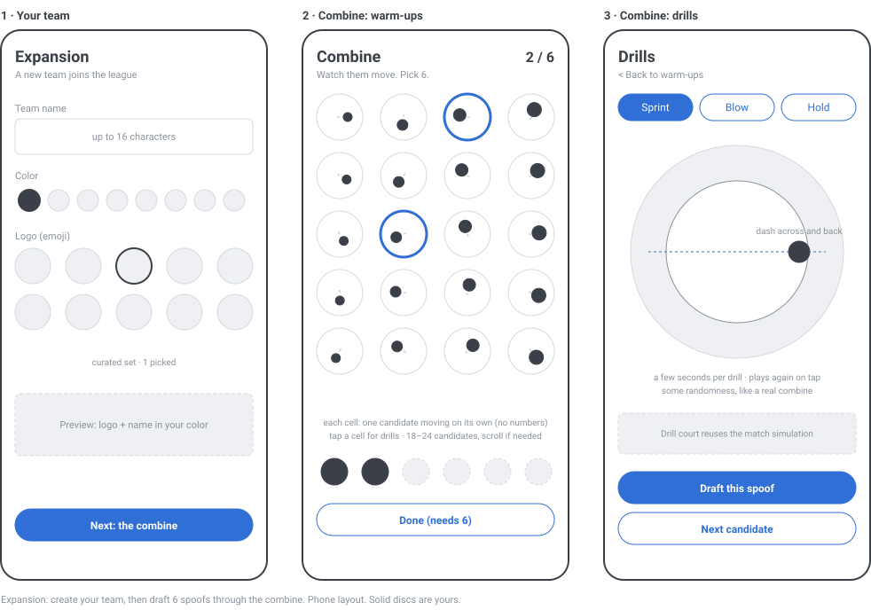
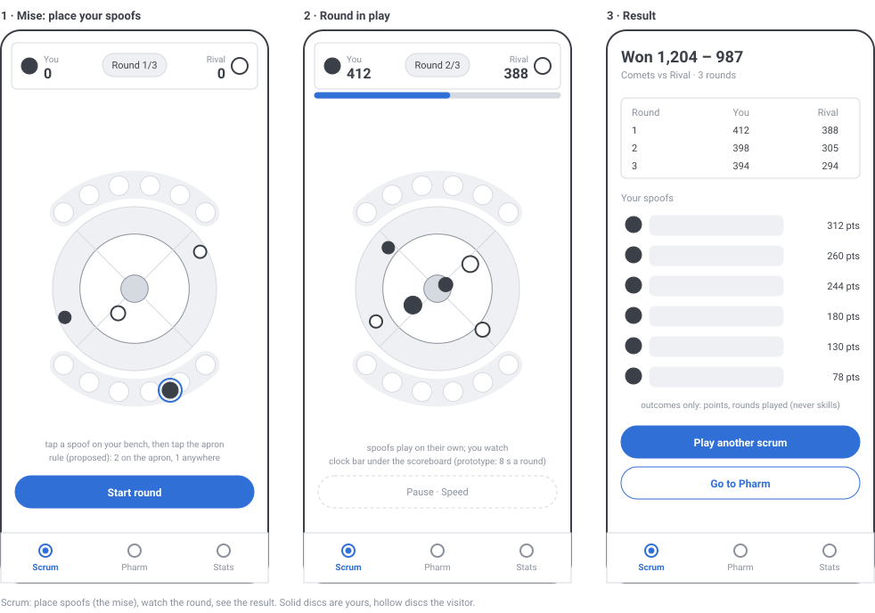
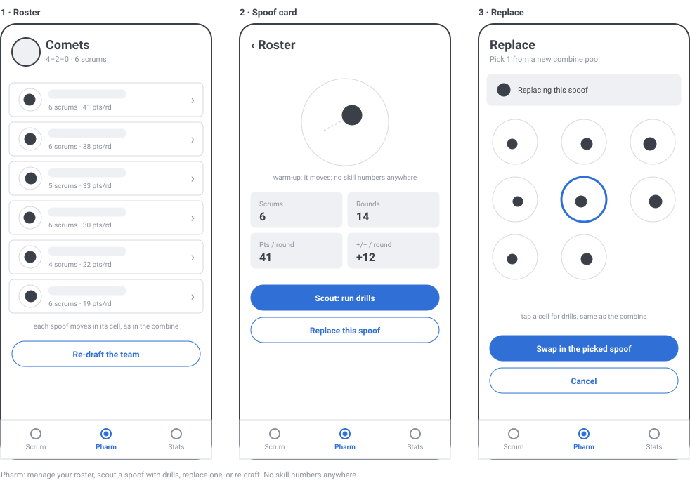
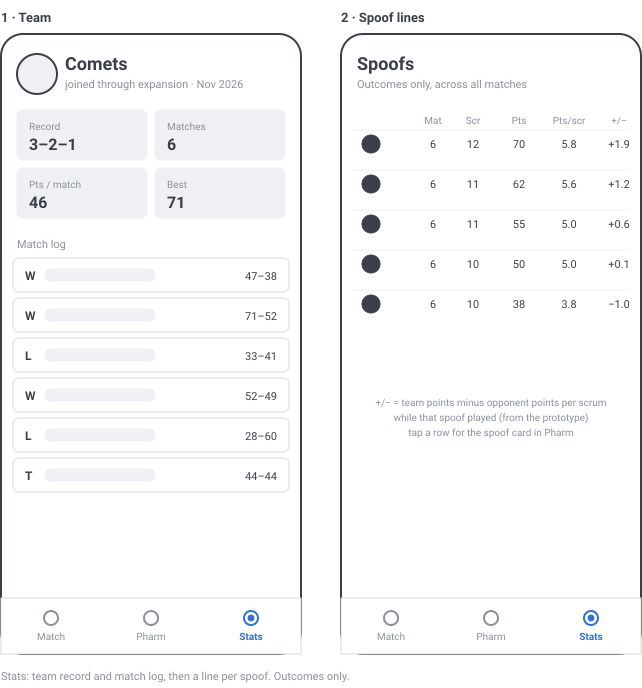

# Spoofball design

How Spoofball looks and why. The live [style guide](https://klenwell.com/spoofball/style/) shows the current tokens and components. This document records the decisions behind them.

- **Tokens:** `src/design/tokens.ts` is the single source of truth. CSS reads the tokens as custom properties (`--color-mosh`, `--team-blue`, `--space-4`, …), which `installDesignTokens()` generates. Canvas drawing code imports them directly.
- **Epic:** [#16 Design direction](https://github.com/klenwell/spoofball/issues/16).

## Decisions (2026-11-20)

These were chosen by the owner from a set of mockup comparisons.

1. **Feel: dark, minimal, built from circles.**
   - It refines the prototype's look: a near-black background (`--color-background`), calm surfaces, and geometric shapes.
   - **Why:** the dark page frames the light court like an arena under lights, so the eye goes to the play. It also suits round discs on a round court.
2. **Arena: a circular court with three scoring zones, and a bench for each team, on the dark page.**
   - The owner set the names, colors and layout on #19 (2026-11-20), keeping the prototype's proportions (`court.py`, `match.js`). The positions are in court units (court radius 150) in `src/game/court.ts` and `src/game/arena.ts`.

     | Zone      | Radius  | Look                                                           | Score |
     | --------- | ------- | -------------------------------------------------------------- | ----- |
     | **Apron** | 100–150 | gray outer ring (`--color-apron`)                              | ×0    |
     | **Mosh**  | 0–100   | white circle (`--color-mosh`) with a red outline               | ×1    |
     | **Crush** | 0–25    | red center spot (`--color-crush`), like a hockey face-off spot | ×3    |

   - **Diagonals:** two blue lines (`--color-court-line`) cross the whole court and split it into quarters. They're decorative, a sporty touch, and the owner kept them after review (#19).
   - **Benches** curve around the court as in the prototype's arena mockup: the visitor's above, yours (home) below. Each has 6 seats, one per spoof, spaced 17° apart as in the prototype.
   - **The arena is taller than wide,** so it suits a phone in portrait.
   - **The apron is lighter than the prototype's `#CCCCCC`** (`#D9DCE1`), so every disc's trim keeps at least 3:1 contrast on it.
   - **History:** on #17 the owner chose a light court over the dark court in the first mockups.
   - **Why it matters:** scoring depends on which zone a spoof is in, so the court's markings are part of the game.

3. **Spoof avatars: custom geometric marks,** one per avatar, drawn in code.
   - **First draft:**
     - king: a star;
     - queen: an asterisk with a center dot (the owner's idea in #18, replacing a ring that looked busy at 10 px);
     - rook: a club (♣);
     - bishop: a diamond (♦);
     - knight: a spade (♠);
     - pawn: a dot.
   - **Playing-card suits for the rook, bishop and knight** (the owner's idea in #18). The heart (♥) is unused.
   - **Pawn subtypes are hidden.** There are 8 spoof types but 6 avatars: basic, noble and angry pawns all show the same pawn mark. A subtype shows only through how the pawn plays in a scrum (the owner's decision on #18, 2026-11-20). The prototype did the same, sending only "pawn" to the browser. In code, `avatarOf(type)` maps a spoof type to what the player sees.
   - **Why geometric marks:** they look the same on every device and stay readable on a 10 px disc. Chess glyphs blur at that size, and emoji vary by device and get muddy.
   - **Status:** the owner is refining them in #18.
4. **Team colors: 8 named colors, re-tuned for the light court, with home and away kits.**
   - The names come from the prototype: red, orange, gold, green, teal, blue, purple and pink.
   - Each color is just dark enough to stand out on white, so all 8 have similar weight, and pure red against pure green is avoided.
   - **Cost of the white court:** the light colors had to deepen. Gold is now an olive-leaning `#A98921`, because a bright gold is only about 2:1 on white. Refining colors is part of #19.
   - **Home kit:** a disc filled with the team color (`base`), trimmed in its `deep` shade, with a white mark.
   - **Away kit:** a white disc trimmed and marked in the team color's `deep` shade. The trim uses `deep` rather than `base` so it stays clear on the gray apron. On the light court, the trim and a light drop shadow on every disc are what separate it from the court.
   - **In a scrum, your team is always home and the visitor always wears away** (the owner's decision on #19, 2026-11-20, replacing an earlier "away only when the colors clash" rule).
     - **Why:** you mostly watch a scrum play itself, so you need one constant rule for telling the teams apart: **solid discs are yours, white discs are theirs.** It works whatever the colors, including two teams of the same color. Many sports do the same, with road teams always in white.
     - **Cost:** the opponent's color shows only in its trim, and white discs on the white mosh are quieter, relying on their trim and shadow.
     - See `scrumKits()` in `src/design/kits.ts`.
   - **Why kits:** the owner proposed them on #17, modeled on home and visitor uniforms, because there are only 8 colors and two teams will sometimes share one.
   - **Checked by unit tests:**
     - every disc's trim, in either kit, has at least 3:1 contrast on the mosh and on the apron;
     - every `base` color has at least 3:1 contrast on the white mosh;
     - every home mark (white) has at least 3:1 contrast on its disc;
     - every away mark (`deep`) has at least 4.5:1 contrast on white;
     - every `base` color has at least 3:1 contrast on the dark benches.

     **The crush is the exception.** The owner's red has about the same brightness as the trims, so a disc on the crush stands out by hue and shadow, not by brightness. A red home team on the crush is the weakest case (the visitor is always white). **The owner accepted this for now** (#19, 2026-11-20).

     3:1 is the WCAG minimum for meaningful graphics (WCAG 2.1, 1.4.11).
5. **Navigation: a bottom tab bar on phones, a top bar on desktop.**
   - The tabs are **Scrum · Pharm · Stats**.
   - **Why:** it's the standard phone pattern. It's always visible, reachable with a thumb, and one tap from any screen. The prototype's circular hub was the alternative, but it adds a tap to every move.
6. **Where the design lives:** the live style guide (`/spoofball/style/`) plus this document.
   - **Why:** the owner reviews the design on the real site, where it's rendered exactly as the game renders it.

7. **A spoof's abilities are hidden. Players infer them from how it moves** (the owner's decision on #20, 2026-11-20).
   - No screen shows a spoof's **skills** (11), **comps** (5) or **pawn subtype**: not the draft, not Pharm, not Stats.
   - Spoof cards and stats show only the avatar and **outcomes**: scrums and rounds played, points, points per round, and +/− per round (team points minus opponent points while that spoof played, from the prototype's stats page).
   - **Why:** the game should reward intuition and watching, not number-crunching.
8. **The draft is a combine,** modeled on the NFL Scouting Combine (the owner's idea on #20).
   - **Warm-ups:** every candidate moves on its own in a small round cell, so you can scan the pool like a scout.
   - **Drills:** tap a spoof to open a small drill court with 2–3 short drills, such as _sprint_ (dash across and back), _blow_ (grow from its smallest size) and _hold_ (stay in the mosh while a dummy pushes). Each is a few seconds, with no numbers.
   - **Some randomness,** like a real combine: a spoof shows its traits, but not a perfectly repeatable test.
   - **The combine reuses the scrum simulation,** so a spoof behaves in drills exactly as it will in a scrum. So Expansion, which builds the combine, depends on the Scrum epic.
   - **Scouting in Pharm:** you can run drills on your own spoofs before replacing one. Replacing uses a small combine pool. The prototype's pharm had this idea, but felt clunky, so the owner wants it **clean and easy to use**.

## Wireframes

Low-fidelity phone sketches (#20), to guide the epics that build each screen. They're gray boxes and labels, not designs. Solid discs are yours (home kit) and hollow discs the visitor's (away kit). Regenerate them with `python3 docs/design/wireframes.py docs/design`.

### Expansion

1. **Your team:** a name (up to 16 characters, as in the prototype), one of the 8 colors, and an emoji logo, with a preview.
2. **Combine warm-ups:** a grid of candidate cells, each spoof moving in its own cell. Picked cells are outlined, and a strip at the bottom fills to 6.
3. **Drills:** sprint, blow and hold tabs on a small court. "Draft this spoof" or "Next candidate".

There's no tab bar until the team exists. On desktop, the warm-up grid widens to more columns and the drill court opens beside it.

### Scrum

1. **Mise:** the scoreboard on top, then the arena. Tap a spoof on your bench (below), then tap the apron to place it.
2. **Round in play:** a clock bar under the scoreboard. The spoofs play on their own while you watch.
3. **Result:** the final score, the score by round, and each of your spoofs' points.

On desktop, the arena sits in the center with the scoreboard above it.

### Pharm

1. **Roster:** your team and its record, then 6 rows, each with a moving spoof and its outcomes. "Re-draft the team" runs a full combine.
2. **Spoof card:** the spoof warming up in its cell, its outcomes, then "Scout: run drills" and "Replace this spoof".
3. **Replace:** a small combine pool of about 8. Tap a cell for drills, then pick one and swap it in.

### Stats

1. **Team:** record, scrums played, points per scrum, best score, and a scrum log.
2. **Spoof lines:** a row per spoof with scrums, rounds, points, points per round and +/− per round. Tap a row to open its card in Pharm.

## Open questions, by epic

These came up while sketching. Each is settled when its epic is planned.

- **Scrum**
  - **Placement rule:** the owner's current idea is that at the start, 2 spoofs must be on the apron and 1 may be on the court. How many spoofs play each round (the prototype placed 3 per team), and who places first? The prototype alternated turns, with the host placing last.
  - **Round length:** the prototype used 8 seconds. Is there overtime on a tie (the prototype tracked an OT round)?
  - **Watching controls:** pause and speed-up while a round plays?
- **Expansion**
  - **Do spoofs have names?** The rows in the wireframes leave a gray bar for one.
  - **Emoji logo:** any emoji, or a curated set?
  - **Combine pool:** how many candidates (18–24), how many drills, and which ones?
- **Pharm**
  - **When can you replace or re-draft?** Any time between scrums, or limited, and does it cost anything?
- **Stats**
  - **Which outcomes to show:** the prototype also counted behavior such as hits given and taken ("dings" and "dongs"). These describe what happened, not abilities. Should any appear?

## Tokens at a glance

| Group       | Tokens                                                                                                                                                                                    |
| ----------- | ----------------------------------------------------------------------------------------------------------------------------------------------------------------------------------------- |
| Palette     | `background`, `surface`, `mosh`, `apron`, `crush`, `mosh-line`, `court-line`, `bench`, `seat`, `court-text`, `text`, `text-muted`, `line`, `accent`, `white`, `highlight`, as `--color-*` |
| Team colors | `red`, `orange`, `gold`, `green`, `teal`, `blue`, `purple`, `pink`, as `--team-*` (base) and `--team-*-deep`                                                                              |
| Type        | `--font-body` (system UI), `--font-numeric` (monospace, for scores). Sizes from `--text-xs` to `--text-display`, on a 1.25 scale                                                          |
| Spacing     | `--space-1` to `--space-12`, on a 4 px grid                                                                                                                                               |
| Radii       | `--radius-sm`, `-md`, `-lg`, `-pill`, `-circle`                                                                                                                                           |

## Glossary

| Term             | Meaning                                                                                                                                                                                  |
| ---------------- | ---------------------------------------------------------------------------------------------------------------------------------------------------------------------------------------- |
| **Spoof**        | A player: a 2D disc. A team has 6. (The prototype called them "rooks".)                                                                                                                  |
| **Spoof type**   | A spoof's archetype. It's fixed when the spoof is created and shapes its skill rolls. The types are king, queen, rook, bishop and knight, plus three pawns: basic, noble and angry       |
| **Avatar**       | The mark a player sees on a spoof. There's one per type, except that every pawn shows the same pawn avatar                                                                               |
| **Pawn subtype** | Basic, noble or angry. Hidden from the player: it shows only through how the pawn plays in a scrum                                                                                       |
| **Scrum**        | A match against one other team, played over 3 rounds                                                                                                                                     |
| **Round**        | One period of a scrum. Spoofs are placed, then play on their own for a fixed time                                                                                                        |
| **Arena**        | The whole playing area: the court and both benches                                                                                                                                       |
| **Court**        | The circular playing area, made of the apron, the mosh and the crush. Where a spoof is on the court sets its score                                                                       |
| **Apron**        | The court's gray outer ring. Scores nothing (×0). Spoofs start a scrum here                                                                                                              |
| **Mosh**         | The court's large white circle. Scores ×1                                                                                                                                                |
| **Crush**        | The red spot at the center of the mosh. Scores ×3                                                                                                                                        |
| **Bench**        | A team's curved row of seats beside the court: the visitor's above, yours below                                                                                                          |
| **Seat**         | A spot on a bench where a spoof waits before it's placed on the court. Each bench has 6                                                                                                  |
| **Kit**          | How a team's discs look in a scrum: **home** (filled with the team color) or **away** (white, trimmed in the team color). Your team always wears home, and the visitor always wears away |
| **Expansion**    | Creating your team: name, color and emoji logo, then the draft. In sports, a league adds new teams through expansion                                                                     |
| **Draft**        | Picking your 6 spoofs from a generated pool of 18–24                                                                                                                                     |
| **Combine**      | How you draft: candidate spoofs show their abilities by moving, in warm-ups and drills, like the NFL Scouting Combine                                                                    |
| **Warm-up**      | A candidate moving on its own in a small round cell, so you can compare a whole pool at a glance                                                                                         |
| **Drill**        | A short exercise on a small court (sprint, blow, hold) that shows one or two of a spoof's traits, without numbers                                                                        |
| **Pharm**        | Managing your team: your roster, replacing a spoof, re-drafting. From "farm system"                                                                                                      |
| **Stats**        | Your team's record and each spoof's numbers across scrums                                                                                                                                |
