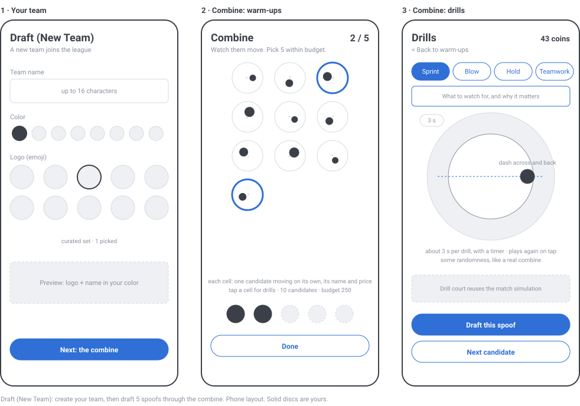
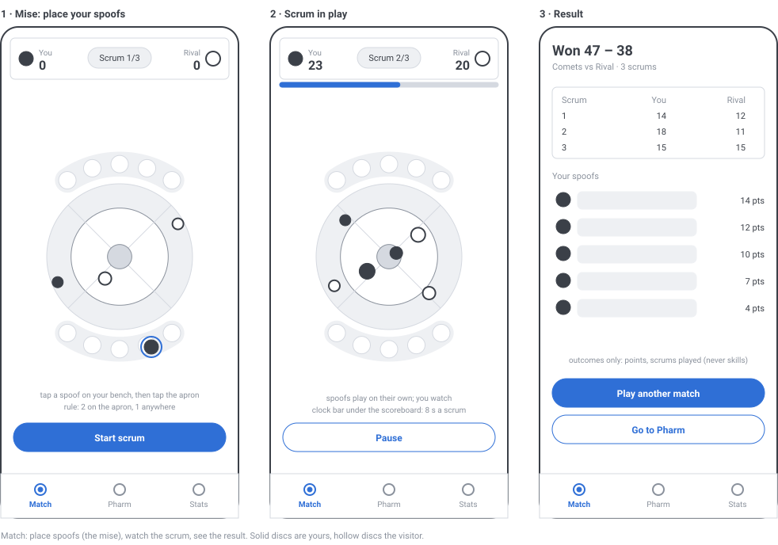

# Spoofball design

How Spoofball looks and why. The live [style guide](https://klenwell.com/spoofball/style/) shows the current tokens and components. This document records the decisions behind them.

- **Tokens:** `src/design/tokens.ts` is the single source of truth. CSS reads the tokens as custom properties (`--color-mosh`, `--team-blue`, `--space-4`, …), which `installDesignTokens()` generates. Canvas drawing code imports them directly.
- **Epic:** [#16 Design direction](https://github.com/klenwell/spoofball/issues/16).

## Decisions (2026-11-20)

These were chosen by the owner from a set of mockup comparisons.

1. **Feel: light, flat, modern, built from circles** (the owner's decision on #30, 2026-11-21).
   - An off-white page (`--color-background`, `#F5F6F8`), white bars and cards (`--color-surface`), dark text, hairline borders, and geometric shapes. No gradients, and **flat discs with no shadow** (the owner's pick on #30, after comparing both).
   - **Why:** it's clean and easy to read on a phone, and it suits the white court. It's mockup (b) from the first comparison.
   - **History:** on 2026-11-20 the owner first chose (a), dark and minimal, refining the prototype's near-black look. Seeing the app shell (#21), they preferred (b), light, flat, modern. Since the court had already turned white (#17) and the wireframes were light, the switch was mostly a change of tokens (#30).
2. **Arena: a circular court with three scoring zones, and a bench for each team.**
   - The owner set the names, colors and layout on #19 (2026-11-20), keeping the prototype's proportions (`court.py`, `match.js`). The positions are in court units (court radius 130 since #51; the prototype's was 150) in `src/game/court.ts` and `src/game/arena.ts`.

     | Zone      | Radius | Look                                                                                                                                                                                                | Score |
     | --------- | ------ | --------------------------------------------------------------------------------------------------------------------------------------------------------------------------------------------------- | ----- |
     | **Apron** | 80–130 | gray outer ring (`--color-apron`)                                                                                                                                                                   | ×0    |
     | **Mosh**  | 0–80   | white circle (`--color-mosh`) with a red outline                                                                                                                                                    | ×1    |
     | **Crush** | 0–25   | red center spot (`--color-crush`), like a hockey face-off spot, inside a thin red ring whose outer edge is the crush's edge, with a 1-unit white gap between them (as in the prototype; owner, #22) | ×3    |

   - **Diagonals:** two blue lines (`--color-court-line`) cross the whole court and split it into quarters. They're decorative, a sporty touch, and the owner kept them after review (#19).
   - **Benches** curve around the court as in the prototype's arena mockup: the visitor's above, yours (home) below. Each has 5 seats, one per spoof, spaced 17° apart and centered on its side of the court, as in the prototype (#44; the first version had 6).
   - **The arena is taller than wide,** so it suits a phone in portrait.
   - **The apron is lighter than the prototype's `#CCCCCC`** (`#D9DCE1`), so every disc's trim keeps at least 3:1 contrast on it.
   - **A gray edge** (`--color-court-edge`, 3:1 on the page) shows where the court ends, because the apron is close to the light page's color (#30).
   - **The benches are white with a thin outline** (`--color-bench-edge`), and the seats light gray. A light gray bench would drop 5 of the 8 team colors below 3:1 (#30).
   - **History:** on #17 the owner chose a light court over the dark court in the first mockups.
   - **Why it matters:** scoring depends on which zone a spoof is in, so the court's markings are part of the game.

3. **Spoof avatars: custom geometric marks,** one per avatar, drawn in code.
   - **First draft:**
     - king: a star;
     - queen: an asterisk with a center dot (the owner's idea in #18, replacing a ring that looked busy at 10 px);
     - rook: a club (♣);
     - bishop: a diamond (♦);
     - knight: a spade (♠);
     - pawn: a dot.
   - **Playing-card suits for the rook, bishop and knight** (the owner's idea in #18). The heart (♥) is unused.
   - **Pawn subtypes are hidden.** There are 8 spoof types but 6 avatars: basic, noble and angry pawns all show the same pawn mark. A subtype shows only through how the pawn plays in a match (the owner's decision on #18, 2026-11-20). The prototype did the same, sending only "pawn" to the browser. In code, `avatarOf(type)` maps a spoof type to what the player sees.
   - **Why geometric marks:** they look the same on every device and stay readable on a 10 px disc. Chess glyphs blur at that size, and emoji vary by device and get muddy.
   - **Status:** the owner is refining them in #18.
4. **Team colors: 8 named colors, re-tuned for the light court, with home and away kits.**
   - The names come from the prototype: red, orange, gold, green, teal, blue, purple and pink.
   - Each color is just dark enough to stand out on white, so all 8 have similar weight, and pure red against pure green is avoided.
   - **Cost of the white court:** the light colors had to deepen. Gold is now an olive-leaning `#A98921`, because a bright gold is only about 2:1 on white. Refining colors is part of #19.
   - **Home kit:** a disc filled with the team color (`base`), trimmed in its `deep` shade, with a white mark.
   - **Away kit:** a white disc trimmed and marked in the team color's `deep` shade. The trim uses `deep` rather than `base` so it stays clear on the gray apron. On the light court, the trim and a light drop shadow on every disc are what separate it from the court.
   - **In a match, your team is always home and the visitor always wears away** (the owner's decision on #19, 2026-11-20, replacing an earlier "away only when the colors clash" rule).
     - **Why:** you mostly watch a match play itself, so you need one constant rule for telling the teams apart: **solid discs are yours, white discs are theirs.** It works whatever the colors, including two teams of the same color. Many sports do the same, with road teams always in white.
     - **Cost:** the opponent's color shows only in its trim, and white discs on the white mosh are quieter, relying on their trim and shadow.
     - See `matchKits()` in `src/design/kits.ts`.
   - **Why kits:** the owner proposed them on #17, modeled on home and visitor uniforms, because there are only 8 colors and two teams will sometimes share one.
   - **Checked by unit tests:**
     - every disc's trim, in either kit, has at least 3:1 contrast on the mosh, the apron, the benches and the seats;
     - every `base` color has at least 3:1 contrast on the white mosh;
     - every home mark (white) has at least 3:1 contrast on its disc;
     - every away mark (`deep`) has at least 4.5:1 contrast on white;
     - every `base` color has at least 3:1 contrast on the white benches;
     - on the page and on surfaces, text and muted text have at least 4.5:1 contrast, the accent at least 3:1 (it's for graphics), and `--color-accent-text` at least 4.5:1 (for labels and links).

     **The crush is the exception.** The owner's red has about the same brightness as the trims, so a disc on the crush stands out by hue alone, not by brightness. (Until #30 a light shadow helped too; the discs are flat now.) A red home team on the crush is the weakest case (the visitor is always white). **The owner accepted this for now** (#19, 2026-11-20).

     3:1 is the WCAG minimum for meaningful graphics (WCAG 2.1, 1.4.11).
5. **Navigation: a bottom tab bar on phones, a top bar on desktop.**
   - The tabs are **Match · Pharm · Stats** (renamed from Scrum on #20, 2026-11-20, when "match" became the whole contest).
   - **Each tab has its own URL** (`#/match`, `#/pharm`, `#/stats`), so Back, Forward and reload behave as on any website (#21). A missing or unknown hash opens Match. The tabs are links in a `<nav>`, with `aria-current="page"` on the current one, and focus moves to the new screen's heading after a tab change. See `src/ui/tabs.ts`.
   - **Why:** it's the standard phone pattern. It's always visible, reachable with a thumb, and one tap from any screen. The prototype's circular hub was the alternative, but it adds a tap to every move.
6. **Where the design lives:** the live style guide (`/spoofball/style/`) plus this document.
   - **Why:** the owner reviews the design on the real site, where it's rendered exactly as the game renders it.

7. **A spoof's abilities are hidden. Players infer them from how it moves** (the owner's decision on #20, 2026-11-20).
   - No screen shows a spoof's **skills** (11), **comps** (5) or **pawn subtype**: not the draft, not Pharm, not Stats.
   - **This is stricter than the prototype.** The prototype never showed skills, but its Pharm roster showed each spoof's 5 comps as "spangles": a circle per comp, sized and colored from red to green by its value, with an icon (`CompSpangle` in `public/js/app/models/rook.js`). There were no numbers, but you could read them at a glance.
   - Spoof cards and stats show only the avatar and **outcomes**: matches and scrums played, points, points per scrum, and +/− per scrum (team points minus opponent points while that spoof played, from the prototype's stats page).
   - **Why:** the game should reward intuition and watching, not number-crunching.
   - **A price is the one number the combine shows** (#72, the owner, 2026-11-23). It's a rough, deliberately noisy hint of a candidate's raw skill total, never of a single skill, and it doesn't reflect which skills a spoof has.
8. **The draft is a combine,** modeled on the NFL Scouting Combine (the owner's idea on #20).
   - **Warm-ups:** every candidate moves on its own in a small round cell, so you can scan the pool like a scout.
   - **Drills:** tap a spoof to open a small drill court with 2–3 short drills, such as _sprint_ (dash across and back), _blow_ (grow from its smallest size) and _hold_ (stay in the mosh while a dummy pushes). Each is a few seconds, with no numbers.
   - **Some randomness,** like a real combine: a spoof shows its traits, but not a perfectly repeatable test.
   - **The combine reuses the match simulation,** so a spoof behaves in drills exactly as it will in a match. So the Draft (New Team) epic, which builds the combine, depends on the Match epic.
   - **Scouting in Pharm:** you can run drills on your own spoofs before replacing one. Replacing uses a small pool of 3 prospects. The prototype's pharm had this idea, but felt clunky, so the owner wants it **clean and easy to use**.

## Wireframes

Low-fidelity phone sketches (#20), to guide the epics that build each screen. They're gray boxes and labels, not designs. Solid discs are yours (home kit) and hollow discs the visitor's (away kit). Regenerate them with `python3 docs/design/wireframes.py docs/design`.

### Draft (New Team)

1. **Your team:** a name (up to 16 characters, as in the prototype), one of the 8 colors, and an emoji logo, with a preview.
2. **Combine warm-ups:** a grid of candidate cells, each spoof moving in its own cell, with its name and price. Picked cells are outlined, and a strip at the bottom fills to 5, with the budget left (#72).
3. **Drills:** sprint, blow and hold tabs on a small court. "Draft this spoof" or "Next candidate".

There's no tab bar until the team exists. On desktop, the warm-up grid widens to more columns and the drill court opens beside it.

### Match

1. **Mise:** the scoreboard on top, then the arena. Tap a spoof on your bench (below), then tap the apron to place it.
2. **Scrum in play:** a clock bar under the scoreboard. The spoofs play on their own while you watch, and you can pause.
3. **Result:** the final score, the score by scrum, and each of your spoofs' points.

On desktop, the arena sits in the center with the scoreboard above it.

### Pharm

1. **Roster:** your team and its record, then 5 rows, each with a moving spoof and its outcomes. "Re-draft the team" runs a full combine.
2. **Spoof card:** the spoof warming up in its cell, its outcomes, then "Scout: run drills" and "Replace this spoof".
3. **Replace:** 3 prospects, for one draft pick. Tap a cell for drills, then pick one and swap it in. Your picks show as 3 dots.

### Stats

1. **Team:** record, matches played, points per match, best score, and a match log.
2. **Spoof lines:** a row per spoof with matches, scrums, points, points per scrum and +/− per scrum. Tap a row to open its card in Pharm.

## Decisions for later epics (2026-11-20)

The owner settled these while reviewing the wireframes on #20. Each epic still refines the details when it's planned.

### Match

- **The mise follows the prototype** (`mise.py`). Each team places 3 spoofs before every scrum, in 6 turns.
  - The **host** places last (turn 6). For now the host is picked at random each match, separately from kits and benches.
  - The other team places on turn 4 or 5, at random. The remaining turns are random, except that a team can't take its last turn while the other team hasn't taken its first. The order is new every scrum.
  - **Placement rule:** of each team's 3, at least 2 go on the apron and at most 1 anywhere on the court.
- **A team has 5 spoofs** (the owner, on #43, 2026-11-21), as in the prototype; the pitch's 6 had carried through by mistake. With 3 on the court each scrum, only 2 can rest, so at least one spoof plays two scrums in a row. Who plays tired, and who gets the full rest from sitting out, is a coaching decision.
- **Fatigue carries across a match's scrums.** Between scrums every spoof recovers part of the way (up to 66%), and a spoof that sat out a scrum can recover fully. Recovery depends on hidden stamina and impact, plus some randomness. Fatigue resets each match.
- **Spoofs move as in the prototype** (the owner, on #46, 2026-11-21). There's no acceleration or friction. A spoof thinks a few times a second, more often with high iq and as the clock runs down, and heads for its goal at its burst speed. It coasts and grows between thoughts, skids on reaching its goal, and tires about 20 times a scrum.
  - **Spoofs only grow during a scrum.** Tiring slows their growth, but nothing shrinks them.
  - **Grace sets how a spoof skids and turns** (burst, constancy and stamina). Mass only matters in collisions, where the heavier spoof is pushed less.
  - Shrinking on hits, and mass in turning, are ideas for later: #47.
- **The spoof AI builds what the prototype meant, not how it played** (the owner, on #37, 2026-11-21). The prototype's AI had bugs: its spoofs mostly drifted toward the nearest group, ignoring the crush, and its charges at opponents never expired, because they timed out by wall-clock time. Here:
  - a spoof surveys the spots within its vision (range from vision, detail from iq), and values each by zone and by the teammates sharing it, the same overlap bonus scoring uses;
  - it prefers nearer spots a little, and misjudges more with low smarts;
  - it holds its spot when nothing it sees is worth more;
  - it charges a spot crowded with 2 or more opponents, until it hits one;
  - each time it thinks, it re-values its current goal on the court as it is now, and keeps it only if nothing it sees is worth more. Only charges expire, after 1.5 seconds of game time, so a spoof doesn't chase a spot it can't reach (the owner, on #48);
  - teammates share goals as in the prototype: sent by leadership, followed by charisma and cooperation. A followed goal keeps the sender's persuasion (charisma × 0.015, up to 1.5) as a weight on its value. A spoof steers for a followed goal at its next thought, as in the prototype, so a quick-thinking spoof acts on advice sooner (the owner, on #48);
  - a spoof re-aims at its goal every time it thinks, as in the prototype, so one knocked off course heads back.
- **How lively scrums are** (the owner, on #49, 2026-11-21, after watching scrums with review-only sliders):
  - **Opponents bounce a little,** at a bounciness of 0.25: they rebound with a quarter of their closing speed, then push. The prototype only shoved, because of a bug (#34).
  - **Spoofs think at 3× the prototype's pace.** The whole iq curve is scaled, so a spoof at iq 99 decides about 12 times a second and one at iq 1 about once a second. Past about 3×, more thinking made spoofs hold good spots more, flattened the skill edge, and cost smart spoofs growth (#50).
  - **A skid keeps at least 10% of a spoof's speed,** so a spoof reaching its goal drifts on rather than stopping dead. Grace still decides the rest.
- **Spoofs attack** (the owner, on #51, 2026-11-22). Watching scrums, the owner found each team settled on its own patch of court. Now spots with opponents on them pull spoofs in, for knocking them off and denying the other team points:
  - **Temperament:** every spoof has a hidden temperament, how keen it is to attack. It's its own trait, **not a skill**: it sits outside the skill budget, so it's a style of play, neither better nor worse. It varies by type: angry pawns run hottest (1.7 on average), then knights (1.4), rooks (1.2), kings and basic pawns (1), queens (0.8), bishops (0.7) and noble pawns (0.5), each spoof within ±0.4. It's never shown on screen.
  - **Appetite = aggression level × 2 × (temperament − 0.7).** Above 0.7 a spoof is drawn to opponents, and a hot one charges even a single opponent. **Below 0.7 it's shy:** it steers around opponents and never charges. Simply scaling by temperament left hot and calm spoofs landing the same hits, so the owner chose shy calm spoofs.
  - **The aggression level is 2** (the owner, on #51, 2026-11-22): it made matches more kinetic.
- **The mosh can be smaller** (the owner, on #51). Only the mosh shrinks: the crush stays at radius 25, and the apron stays a ring 50 wide, room to place a full-size spoof. The court's radius is always the mosh's plus 50. **The owner picked a mosh of 80** (2026-11-22), so the court's radius is 130, down from the prototype's 150. The preset lineups and the style guide's samples were moved onto it with `fitToCourt`, keeping each spoof in the same zone.
- **Hits show a ring burst** (the owner, on #53, 2026-11-22). A contact between opponents usually lasts a single simulated frame, so without a cue the eye reads it as spoofs stopping just short. Each new contact, the same hits counted as dings and dongs, shows a ring bursting outward from the point of contact for **0.25 s**, thinning and fading as it goes. It's drawn in the dark highlight ink, which reads on the white mosh, the gray apron and the red crush. On review-only controls, the owner picked the ring burst over a squash of the two discs or both, and 0.25 s from 0.1–0.4 s. It's purely visual: the simulation, scores and stats are unchanged. With the player's reduced-motion setting, the ring stays one size and only fades.
- **The mise** (#39). Before the scrum, you and the Embers take turns placing 3 spoofs each, in the order the rules above give. A row of 6 dots, one a turn in each team's kit, shows whose turn it is, and the scoreboard counts each team's spoofs left to place.
  - **Your turn: drag a spoof from your bench onto the court,** as in the prototype (the owner, 2026-11-22), **or tap** it and then tap a spot (the owner chose to keep tapping too). While you drag, the spoof shows where it would land: a green halo on a spot it may go, or faint with a dashed ring on one it may not, with the reason in the caption. On a touch screen it's held 30 court units above your finger, so you can see it. When it would use your one spot inside the red line, the red line is drawn heavier and the caption says so. **The red line resists** (the owner, 2026-11-22): dragged from the apron, a spoof stays against the line on the apron side until it's pushed 24 court units past it (the owner tried 12, then 18), even while your spot inside is unused, so it's never used by accident. Once across, it moves freely inside. **Once your spot inside is used, the line stops a dragged spoof altogether:** it slides along the line on the apron side, and lets go there. Taps go where you aim. **A dragged spoof stops against other spoofs** (the owner, #61, 2026-11-22), yours or the Embers', just touching them, and slides around them as you keep dragging; it's never shown over one. Let go on a spot that isn't allowed, or on your bench, and it goes back to its seat.
  - **The nudge:** a spot too close to another spoof, off the edge, or just over the red line when it must go on the apron is moved to the nearest spot that fits, up to 10 court units, about half the smallest spoof's width. Further than that, it's refused.
  - **A grace period of 1 s** (the owner, 2026-11-22; the prototype's was 1.5 s): after you place a spoof, a ring fills around it. Until it's full, drag the spoof somewhere else (the ring starts again), or back onto your bench. Picking another bench spoof meanwhile swaps it in. When the ring is full, the spoof locks and the turn passes.
  - **The caption** (what to do now, or why a spot is refused) sits over the Embers' bench, on a white panel 80% opaque (the text fully opaque), so it's on screen whenever the arena is (the owner, 2026-11-22; above the court it scrolled out of view). Presses pass through it. Its type scales with the arena, 12 to 16 px, so the longest caption still fits on the bench on a small phone. During the scrum it says how to pause. The scoreboard shows each team's spoofs left to place, then its points.
  - **The scrum starts by itself** once all 6 spoofs are placed, after a 1-second cue: "Scrum!" over the court (the owner, 2026-11-22).
  - **The Embers' turn:** after a 0.9-second pause, they place a random spoof from their bench at a random valid spot, every point on the court equally likely. So they use their one spot inside the red line in almost every mise (the inside is far bigger than the ring of apron a whole spoof fits in). They're outlined until your next move, so you can see where they went. The prototype's computer coach only placed on the apron, hugging the mosh.
  - **Keyboard placing** is saved for an accessibility epic (#55).
  - A match's host, turn order, the Embers' moves and the scrum all come from one seed, so with your taps a match can be replayed.
- **A match** (#40) is 3 scrums against the Embers, each with its own mise. The scoreboard shows which scrum it is ("Scrum 2/3") and the match score, with this scrum's live score added while it plays.
  - **When a scrum ends, a beat of 1.25 s** (the owner, #59, 2026-11-22): the court stays in view with the spoofs where they settled, and the caption says the scrum is over, before its result appears.
  - **Between scrums, a break,** with the scrum's result over the court (the owner, #58, 2026-11-22): a panel 80% opaque (the text fully opaque) with each team's score in that scrum, the match score so far, and what each spoof of both teams scored, or "sat out". **Next scrum** is on the panel and starts the next mise when you're ready (the owner chose a button over an automatic start), so you can look at the board and choose who rests. On the bench, tired spoofs look tired (see-through, as on the court), the clue to who needs a rest. **Every seat on both benches has a small dark crosshatch in its middle** (the owner, #59, 2026-11-22): a fresh spoof hides it, and the more tired a spoof, the more plainly it shows through, a gauge to read fatigue against without changing the spoof. **A spoof is at its most see-through (30% opaque) at fatigue 70** (the owner's pick on #59; it was 100), so a spoof carrying a typical 20–30 fatigue into a mise is 80–70% opaque, on the bench and on the court.
  - **Recovery follows the prototype** (`recuperate`): each tiring skill (growth, burst, iq) regains a random share of what it lost. The most is set by stamina, with impact counting half (`(stamina + impact × 0.5) ÷ 1.5` percent), capped at 66% at the break; constancy raises the least (that same stamina-and-impact figure × constancy ÷ 100 × 0.5, so always under half of it). Fatigue drops by the share regained. A spoof that sat the scrum out rests first, with a cap of 100%, then takes the break too. Nothing recovers after the last scrum. Recovery restores toward the spoof's form for the match (below), not its own skills.
  - **Skills skew by match and by scrum** (the owner, #62, 2026-11-22), after the prototype's `apply_constancy_skew` and `apply_teammate_impact`. Both are hidden, and both come from the match's seed. Only the prototype's seven skewed skills move: growth, burst, stamina, iq, vision, charisma and cooperation; never size, mass, impact or constancy. See `src/game/skew.ts`.
    - **Its form, once per match.** At the start of each match, every spoof of both teams is skewed into its form for that match, each skill drawn separately: an impact draw, from (impact − 100)% to impact%, × 20, × a share from −(100 − constancy)% to +(100 − constancy)%. The share's random sign makes it as likely to go up as down whatever the impact, so impact only sets how wide the swing is. It's widest at both extremes, impact 90 and impact 10 alike, and least at 50; constancy narrows it. It lasts the whole match.
    - **A nudge from its court-mates, every scrum.** At the start of each scrum, each spoof on the court is nudged by each of its court-mates in that scrum: the same impact draw × 8, summed, × (100 − constancy)% of the spoof's own constancy. That damping has no random sign, so a high-impact court-mate lifts a spoof on average (about +3 per skill at impact 90, before damping) and a low-impact one drags it down. Spoofs on the bench neither get nor give a nudge. **It lasts only that scrum**: in the prototype it built up from scrum to scrum.
    - **Never extreme:** form and nudge together stay within **±10** of a spoof's own skills (the owner's pick), and within 1–99. Over 600 matches of the preset teams, a skill moves about 2 on average and 6 at the 95th percentile, and the cap binds about 1% of the time. Smart teams still win every time. The Embers' higher impact (64 on average, to the Spoofs' 44) lifts them a little: the Spoofs (then the Comets, renamed on #71) won 26% of computer-placed matches, down from 34%.
  - **The match scorecard** (the owner, #60, 2026-11-22) shows over the arena when the match ends, on the same panel as a scrum's result, after the prototype's box score: who won ("You won, 52–38", or lost, or a tie), each team's score in each scrum and in all, and each spoof of both teams, scrum by scrum, with a dot for a scrum it sat out, and its total. It covers the whole arena and scrolls within, with **Play another match** always in view. That starts a new match: the same teams, a new seed and a new host, and fresh spoofs.
  - **A match record** (`matchRecord` in `src/game/match.ts`) holds the teams, the score by scrum, the result, and each spoof's scrums played, points and behavior stats, ready for the Stats epic to save. It isn't saved yet.
- **The live scoreboard estimates every spoof every frame** (#49). The prototype estimated one spoof a frame, so its live score could end several points off the final score and jump at the whistle. This one ends within about 2. The final score is always the exact one.
- **A scrum lasts 8 seconds.** The prototype simulated 300 frames a scrum. That number isn't fixed: the Match epic picks a frame rate that serves gameplay and performance (the owner, on #27). **It stays at 300 frames** (37.5 a second; #41, 2026-11-22). The tuning above was all done at that rate, drawing is smoothed to the screen's own frame rate, and a scrum simulates in about 18 ms on a CPU slowed 4×, well under the 1-second limit. So neither gameplay nor performance calls for a change.
- **The preset teams aren't equal, and that's fine** (the owner, #62, 2026-11-22). The point of the game is to adjust your team, so an imbalance is expected. With both teams placed by the computer, the Spoofs win about a quarter of matches against the Embers.
- **Match totals stay in the prototype's range,** checked over 60 seeded matches by `src/game/balance.test.ts` (#41). A team's total has a median of about 42 in those matches (46 over 1,000), and over 95% of totals fall between 10 and 100.
- **Ties stand.** A match can end in a tie, and records are win–loss–tie. The prototype had overtime but had turned it off.
- **Scoring follows the prototype** (`scorekeeper.py`). A scrum scores a snapshot of where the spoofs end up: the court area each covers, × 0.002, × the zone multiplier, × **how many teammates cover the same spot**, the spoof itself included. So 2 overlapping teammates score 4× for the team where they overlap, and 3 score 9×: overlapping teammates is part of the game. Opponents on the same spot don't change it. A match usually totals 10–100 points. (Corrected on #34: the first version of this line left out the teammate bonus.)
- **Watching controls: pause only.** Tap to pause and resume. Speed controls and replays wait until after the MVP. Replays are possible because a match can be replayed from its seed.

### Draft (New Team)

- **Spoofs have names** (#28). A name is a playful word and a first name, such as "Dizzy Gus": up to 16 characters, different from every other on its team, ignoring case, and with no word used twice on a team. Every spoof gets one when it's made, computer teams' included, from the same seed as its skills. It shows on the scrum result, the match scorecard and the combine. The word lists are in `src/game/spoof-names.ts`, for the owner's review. You can rename a spoof when you draft it (#72), and later in Pharm.
- **The team logo comes from a curated set of 24 emoji,** shown as a grid (the owner picked them on #77 and #71). Computer teams draw from the same set.
- **The game opens on a splash screen** when there's no saved team (#71): **Create your team**, or a quick start, **Play as Spoofs**, which saves nothing. The **Spoofs** (👻, blue) are the default team, the Comets until v0.2.0. The header shows the team in play and links back to the splash screen to switch.
- **A new team is drafted in the combine** (#72). The create screen's **Next: the combine** opens it, and **Done** saves the team and plays it. If it replaces your saved team, the last check comes at Done. A draft in progress is saved as it changes, so a reload brings back the same pool and picks. Until #72, a new team got 5 generated spoofs, as the prototype's `Team.new` did.
- **The combine has 10 candidates** for your 5 picks (the owner, 2026-11-23, on #69). It was 15 in the first plan, and 18 for a 6-spoof team before #44 made teams 5. Types are drawn with the prototype's type odds. (The prototype never used its type odds in play: it drew types evenly. See #43.)
- **A price and a budget, instead of roster limits** (the owner, on #69 and #72). The prototype's limits (at most 1 royal, at most 2 of each face type) don't apply.
  - **The budget is 250 coins** for all 5. Every pool's prices add up to twice that, 500, so a pool of average spoofs costs about the budget for 5, and the 5 cheapest always fit.
  - **A price is 1 to 100 coins.** It follows the candidate's raw skill total, never which skills it has, plus a jitter. So two spoofs with the same total cost about the same even if one plays far better: spotting the bargains is your strategy and skill.
  - **Strength is spread wider** than a new team's: each candidate's total is drawn evenly within ±75 of 528 a spoof, within its type's limits.
  - **The jitter** is about 12 coins. Over 400 seeded pools, the cheaper of two candidates has more skill points 13% of the time.
  - These are the starting values; the owner settles the budget, spread and jitter in #72's review round.
- **You can rename a spoof as you draft it,** up to 16 characters, unlike any other name in the pool.
- **Warm-ups:** each candidate wanders alone in a small round cell, by the match's own movement rules (thinking, dashing, skidding, bouncing). It doesn't tire or grow there.
- **Three drills:** _sprint_ (hints at burst and stamina), _blow_ (growth and size) and _hold_ (mass and constancy). Each takes about 3 seconds, can be rerun, and varies a little each time. Iq, vision, charisma and cooperation show only in matches.

### Pharm

- **Replacing a spoof costs a draft pick,** as in the prototype (`models/team.py`).
  - A team starts with 3 picks and can hold at most 3. It gets one back after each loss.
  - Replacing happens between matches. You choose from **3 prospects**, scouted with the same warm-ups and drills, and prospects you pass on stay for next time.
  - Keep the prototype's balance rules: a prospect's skill total is based on your weakest spoof, and a team holds at most 1 royal (king or queen) and 2 of each face type (rook, bishop, knight).
- **Re-drafting** runs a full combine (10 candidates since #72). It keeps the team's name, color and logo, but **resets its record and stats, after a clear warning.**

### Stats

- **The MVP shows outcomes only:** record, matches, scrums, points, points per scrum and +/− per scrum.
- **The simulation still records the prototype's behavior stats,** without showing them: imps (decisions), pings and pongs (messages sent and received), heeds and jecks (messages followed and ignored), dings and dongs (hits given and taken), and doves and trees (frames overlapping 1 or 2 teammates). Showing a few, such as dings and dongs as result-screen highlights, is a post-MVP idea. Some of them, like heeds against jecks, would come close to revealing hidden skills.

## Tokens at a glance

| Group       | Tokens                                                                                                                                                                                                                               |
| ----------- | ------------------------------------------------------------------------------------------------------------------------------------------------------------------------------------------------------------------------------------ |
| Palette     | `background`, `surface`, `mosh`, `apron`, `court-edge`, `crush`, `mosh-line`, `court-line`, `bench`, `bench-edge`, `seat`, `court-text`, `text`, `text-muted`, `line`, `accent`, `accent-text`, `white`, `highlight`, as `--color-*` |
| Team colors | `red`, `orange`, `gold`, `green`, `teal`, `blue`, `purple`, `pink`, as `--team-*` (base) and `--team-*-deep`                                                                                                                         |
| Type        | `--font-body` (system UI), `--font-numeric` (monospace, for scores). Sizes from `--text-xs` to `--text-display`, on a 1.25 scale                                                                                                     |
| Spacing     | `--space-1` to `--space-12`, on a 4 px grid                                                                                                                                                                                          |
| Radii       | `--radius-sm`, `-md`, `-lg`, `-pill`, `-circle`                                                                                                                                                                                      |

## Glossary

| Term             | Meaning                                                                                                                                                                                                 |
| ---------------- | ------------------------------------------------------------------------------------------------------------------------------------------------------------------------------------------------------- |
| **Spoof**        | A player: a 2D disc. A team has 5. (The prototype called them "rooks".)                                                                                                                                 |
| **Spoof type**   | A spoof's archetype. It's fixed when the spoof is created and shapes its skill rolls. The types are king, queen, rook, bishop and knight, plus three pawns: basic, noble and angry                      |
| **Avatar**       | The mark a player sees on a spoof. There's one per type, except that every pawn shows the same pawn avatar                                                                                              |
| **Pawn subtype** | Basic, noble or angry. Hidden from the player: it shows only through how the pawn plays in a match                                                                                                      |
| **Match**        | A whole contest against one other team, played over 3 scrums                                                                                                                                            |
| **Scrum**        | One period of a match: the mise, then 8 seconds of the spoofs playing on their own. (The prototype called it a round)                                                                                   |
| **Mise**         | Placing spoofs before a scrum, the teams taking turns. The prototype's term                                                                                                                             |
| **Arena**        | The whole playing area: the court and both benches                                                                                                                                                      |
| **Court**        | The circular playing area, made of the apron, the mosh and the crush. Where a spoof is on the court sets its score                                                                                      |
| **Apron**        | The court's gray outer ring. Scores nothing (×0). Spoofs start each scrum here                                                                                                                          |
| **Mosh**         | The court's large white circle. Scores ×1                                                                                                                                                               |
| **Crush**        | The red spot at the center of the mosh. Scores ×3                                                                                                                                                       |
| **Bench**        | A team's curved row of seats beside the court: the visitor's above, yours below                                                                                                                         |
| **Seat**         | A spot on a bench where a spoof waits before it's placed on the court. Each bench has 5                                                                                                                 |
| **Kit**          | How a team's discs look in a match: **home** (filled with the team color) or **away** (white, trimmed in the team color). Your team always wears home, and the visitor always wears away                |
| **Draft**        | Creating your team: its name, color and emoji logo, then picking its 5 spoofs from a generated pool in the combine. The epic that builds it is Draft (New Team) (#69), named Expansion until 2026-11-23 |
| **Combine**      | How you draft: candidate spoofs show their abilities by moving, in warm-ups and drills, like the NFL Scouting Combine                                                                                   |
| **Warm-up**      | A candidate moving on its own in a small round cell, so you can compare a whole pool at a glance                                                                                                        |
| **Drill**        | A short exercise on a small court (sprint, blow, hold) that shows one or two of a spoof's traits, without numbers                                                                                       |
| **Temperament**  | A spoof's hidden keenness to attack: hot spoofs go after opponents, calm ones are shy of them. Not a skill; never shown                                                                                 |
| **Pharm**        | Managing your team: your roster, replacing a spoof, re-drafting. From "farm system"                                                                                                                     |
| **Draft pick**   | What replacing a spoof costs. A team holds up to 3 and gets one back after each loss                                                                                                                    |
| **Prospect**     | A candidate to replace a spoof in Pharm. You choose from 3                                                                                                                                              |
| **Host**         | The team that places last in each mise. For now picked at random each match                                                                                                                             |
| **Stats**        | Your team's record and each spoof's numbers across matches                                                                                                                                              |
